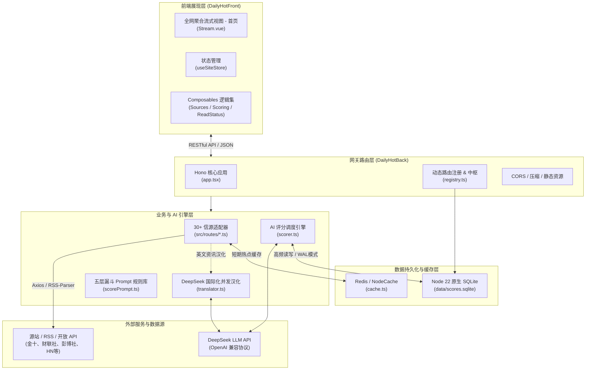
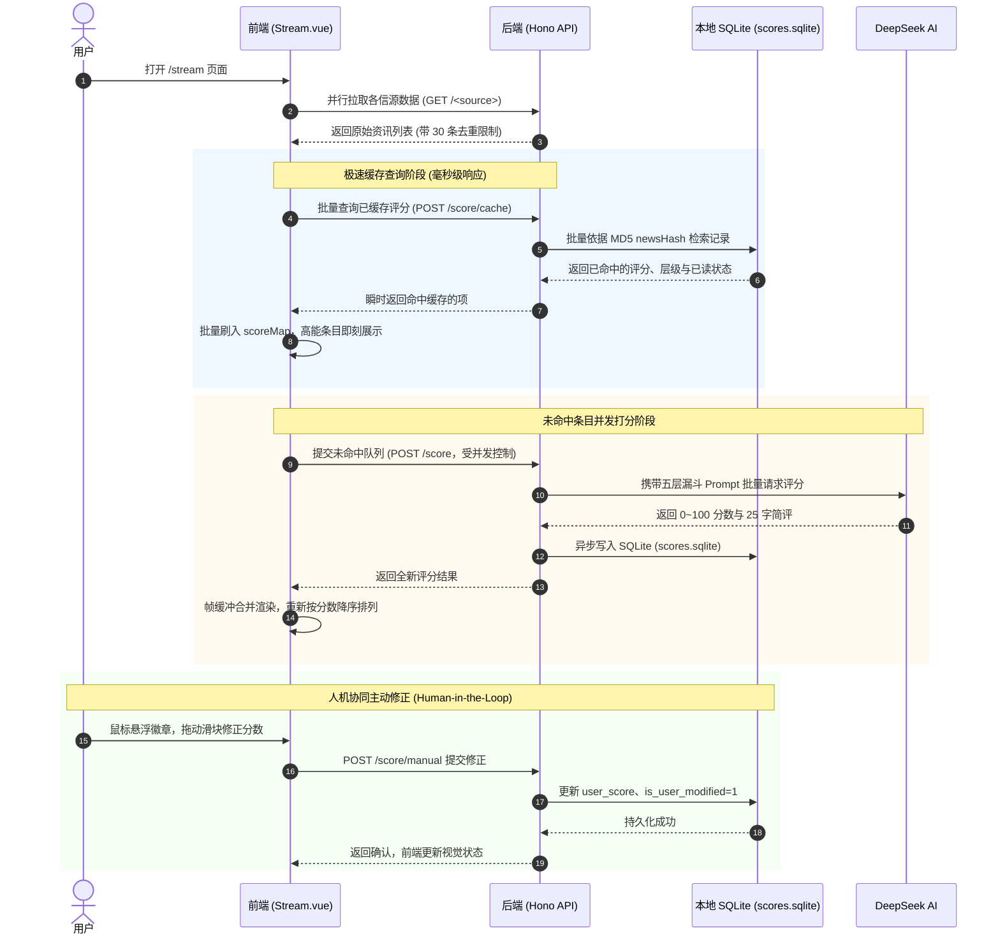
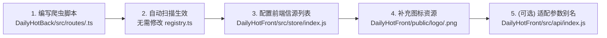

# DailyHot 全栈项目 AI 协作与架构指引手册 (AGENTS.md)

> 本文档专为接入本项目的 **AI Coding Agent（如 Google Antigravity、Claude Code、Cursor、Windsurf 等）** 及人类开发者量身定制。
> 详细阐述 DailyHot 的系统全景架构、双工程职责、数据流向模型，并提供修改特定功能模块时的**精准代码路径指引**与**核心编码规范**。

---

## 目录
1. [项目使命与全局定位](#1-项目使命与全局定位)
2. [技术栈与环境要求](#2-技术栈与环境要求)
3. [整体架构与流水线数据流向](#3-整体架构与流水线数据流向)
4. [项目目录结构全景剖析](#4-项目目录结构全景剖析)
5. [AI 修改特定模块的路径指引 (Roadmap for AI)](#5-ai-修改特定模块的路径指引-roadmap-for-ai)
   - [场景 A：新增或修改资讯爬虫 / 数据源](#场景-a新增或修改资讯爬虫--数据源)
   - [场景 B：调优 AI 评分漏斗规则与 Prompt](#场景-b调优-ai-评分漏斗规则与-prompt)
   - [场景 C：扩展 SQLite 数据库字段与持久化结构](#场景-c扩展-sqlite-数据库字段与持久化结构)
   - [场景 D：修改或增强前端信息流交互 (Stream View)](#场景-d修改或增强前端信息流交互-stream-view)
   - [场景 E：国际化与信源批量并发汉化 (Translator)](#场景-e国际化与信源批量并发汉化-translator)
   - [场景 F：修改经典卡片看板 (Board View) 或全局设置](#场景-f修改经典卡片看板-board-view-或全局设置)
6. [AI 代理开发“黄金铁律”与避坑指南 (Gotchas)](#6-ai-代理开发黄金铁律与避坑指南-gotchas)
7. [本地常用命令与接口调试清单](#7-本地常用命令与接口调试清单)

---

## 1. 项目使命与全局定位

DailyHot 从传统单调的“热榜聚合页面”彻底演化为**面向工程师、投资人与深度思考者的高信噪比实时情报中枢**。

项目由两个独立的工程组合而成：
- **`DailyHotBack` (后端)**：基于 **Hono v4 + DeepSeek AI + Node.js 22 原生 `node:sqlite`** 构建的轻量、高性能实时资讯 API 与智能量化降噪中枢。
- **`DailyHotFront` (前端)**：基于 **Vue 3 + Vite + Naive UI + Pinia** 构建的现代化数字早报看板，提供独创的 **全网聚合流式视图 (Stream View)** 与 **经典多列看板 (Board View)**。

### 核心业务能力
1. **深度 AI 降噪**：采用严苛的五层漏斗（L1~L5 色阶体系，0~100 分），直接识别高能破坏性技术变动与宏观经济决议，压制营销口水。
2. **毫秒级持久化缓存**：基于 Node 22 原生内置 SQLite，无需编译本地 C++ 驱动，基于 MD5 指纹实现一次打分、永久复用。
3. **人机协同 (Human-in-the-Loop)**：前端悬浮滑块支持用户一键手动修正打分，自动记录修正数据，为后续私有化模型/Prompt 校准沉淀样本。
4. **全网已读同步与 Inbox-Zero**：浏览与点击状态沉淀至后端 SQLite，支持“隐藏已读”，实现一键清空全网残留噪声。

---

## 2. 技术栈与环境要求

| 维度 | DailyHotBack (后端) | DailyHotFront (前端) |
| :--- | :--- | :--- |
| **运行时 / 框架** | Node.js >= 22、Hono v4、TypeScript 5 | Vue 3.5、Vite 4.5、JavaScript (ESNext) |
| **持久化与缓存** | 原生 `node:sqlite` (`DatabaseSync`)、Redis / NodeCache | Pinia (`pinia-plugin-persistedstate`)、LocalStorage |
| **AI 引擎** | DeepSeek API (`deepseek-chat` / `deepseek-flash`) | - |
| **组件库 / 样式** | JSX / TSX (内置服务端视图) | Naive UI、@icon-park/vue-next、Sass |
| **包管理器** | `pnpm` | `pnpm` |
| **默认监听端口** | `6688` (可通过 `.env` 修改) | `5173` |

---

## 3. 整体架构与流水线数据流向

### 3.1 架构分层图



### 3.2 流式数据加载与 AI 评分时序



---

## 4. 项目目录结构全景剖析

```
DailyHot/
├── AGENTS.md                          # 🤖 本开发与架构指引手册 (本文件)
│
├── DailyHotBack/                      # 🚀 后端工程 (Node.js 22 + TypeScript + Hono)
│   ├── data/                          # SQLite 数据库持久化存储目录
│   │   ├── scores.sqlite              # 原生 SQLite 主数据库 (WAL模式)
│   │   ├── scores.sqlite-wal          # 预写日志文件
│   │   └── scores.sqlite-shm          # 共享内存索引文件
│   ├── logs/                          # 服务端运行日志 (error.log, logger.log)
│   ├── public/                        # 静态资源 (favicon.png, ico/)
│   ├── src/                           # 核心源码
│   │   ├── index.ts                   # 应用程序入口，监听 6688 端口
│   │   ├── app.tsx                    # Hono 应用初始化、中间件装配 (CORS, compress)
│   │   ├── config.ts                  # 全局环境变量配置读取与校验
│   │   ├── registry.ts                # 路由自动扫描注册中心与核心 API 端点
│   │   ├── types.d.ts                 # 全局 TypeScript 类型契约定义
│   │   ├── robots.txt.ts              # 爬虫协议响应处理
│   │   ├── routes/                    # 30+ 独立资讯爬虫与适配器目录 (自动扫描装载)
│   │   │   ├── jin10.ts               # 金十数据 7x24 全球宏观快讯
│   │   │   ├── cls.ts                 # 财联社 7x24 电报快讯
│   │   │   ├── jiemian.ts             # 界面新闻快报与热榜
│   │   │   ├── bloomberg.ts           # 彭博社海外全球资讯 (带 AI 汉化)
│   │   │   ├── reuters.ts             # 路透社宏观与金融资讯 (带 AI 汉化)
│   │   │   ├── v2ex.ts                # V2EX 开发者热帖与极客主题
│   │   │   ├── hackernews.ts          # Hacker News 全球科技前沿
│   │   │   ├── github.ts              # GitHub Trending 开源趋势
│   │   │   └── ...                    # 其它 20+ 个信源
│   │   ├── utils/                     # 基础工具与核心引擎库
│   │   │   ├── scorer.ts              # DeepSeek 评分核心调度引擎与接口封装
│   │   │   ├── scorePrompt.ts         # 五层漏斗打分 Prompt 模板与真实样本校准规则
│   │   │   ├── scoreDb.ts             # 原生 node:sqlite 数据库读写与预编译操作
│   │   │   ├── translator.ts          # 海外资讯 DeepSeek 批量流式翻译引擎
│   │   │   ├── getData.ts             # Axios HTTP 网络请求封装 (缓存与反爬)
│   │   │   ├── cache.ts               # Redis / NodeCache 统一缓存驱动
│   │   │   ├── deduplicate.ts         # 文章唯一性与标题去重工具
│   │   │   ├── getRSS.ts / parseRSS.ts# RSS 抓取与格式化解析工具
│   │   │   └── logger.ts              # Winston 日志配置
│   │   └── views/                     # 服务端 HTML/JSX 渲染组件 (Home, NotFound, Error)
│   ├── .env                           # 后端环境变量 (DeepSeek Key, Port, Redis 等)
│   ├── Dockerfile                     # 生产 Docker 容器化构建脚本
│   ├── docker-compose.yml             # Docker Compose 编排文件
│   ├── package.json                   # 后端依赖配置
│   └── tsconfig.json                  # TypeScript 编译配置
│
└── DailyHotFront/                     # 💻 前端工程 (Vue 3 + Vite + Naive UI + Pinia)
    ├── public/                        # 静态公共资源
    │   ├── logo/                      # 各信源品牌 Logo 图标 (<sourceName>.png)
    │   ├── favicon.png                # 站点图标
    │   └── sw.js                      # Service Worker (PWA 支持)
    ├── src/                           # 前端源码
    │   ├── main.js                    # 前端入口文件，挂载 Pinia, Router, Naive UI
    │   ├── App.vue                    # 根组件，主题 Provider 与主视图插槽
    │   ├── api/                       # API 请求模块
    │   │   ├── request.js             # Axios 实例、拦截器与 baseURL 配置
    │   │   └── index.js               # 接口调用函数封装 (getHotLists, scoreNews 等)
    │   ├── router/                    # 路由配置
    │   │   ├── index.js               # Vue Router 实例与导航守卫
    │   │   └── routes.js              # 路由表定义 (/, /stream, /setting)
    │   ├── store/                     # Pinia 状态管理
    │   │   └── index.js               # mainStore (主题, 启用的信源列表, 已读状态, 字号)
    │   ├── views/                     # 核心页面视图
    │   │   ├── Stream.vue             # 🌊 全网聚合流式情报主视图 - 首页 (AI 优先重排, 隐藏已读)
    │   │   └── Setting.vue            # ⚙️ 信源管理与个性化设置页面
    │   ├── components/                # 通用组件
    │   │   ├── Header.vue             # 经典顶部导航栏
    │   │   ├── Footer.vue             # 底部信息栏
    │   │   └── Stream/                # 🌊 流式视图专用组件集
    │   │       ├── StreamHeader.vue          # 流式视图顶部控制栏 (搜索, 过滤, 隐藏已读)
    │   │       ├── StreamArticleItem.vue     # 单条资讯卡片 (序号, 徽章, 标题, 摘要, 已读状态)
    │   │       ├── StreamScoreBadge.vue      # L1~L5 评分徽章及悬浮微调滑块弹窗
    │   │       ├── StreamSourceNav.vue       # 顶部各信源快速筛选芯片 Tag 栏
    │   │       ├── StreamProgressFooter.vue  # 悬浮/吸底打分与拉取进度条
    │   │       ├── composables/              # 组合式函数业务拆分
    │   │       │   ├── useStreamSources.js   # 多源并行拉取、聚合与数据标准化
    │   │       │   ├── useStreamScoring.js   # 评分缓存查询、工作队列与帧缓冲更新
    │   │       │   └── useStreamReadStatus.js# 已读标记、交叉观察器与后端持久化同步
    │   │       └── utils/
    │   │           └── scoreUtils.js         # 评分色彩、层级推导与格式化工具函数
    │   ├── style/
    │   │   └── global.scss            # 全局样式规范与主题色彩
    │   └── utils/                     # 辅助函数 (getTime.js 等)
    ├── vite.config.js                 # Vite 打包与开发代理配置
    └── package.json                   # 前端依赖配置
```

---

## 5. AI 修改特定模块的路径指引 (Roadmap for AI)

当 AI 代理被要求执行某一类具体需求时，请严格参考下述路径与规范推进：

### 场景 A：新增或修改资讯爬虫 / 数据源



1. **后端实现新爬虫**：
   - 目标路径：`DailyHotBack/src/routes/<sourceName>.ts`。
   - 必须导出契约：`export const handleRoute = async (c: ListContext, noCache: boolean): Promise<RouterData>`。
   - 请求方法：优先使用 `import { get, post } from "../utils/getData.js"`，自动支持本地缓存与请求头兜底。
   - 解析方式：
     - 若为 JSON 接口：直接在 get 泛型中定义源站数据结构。
     - 若为 HTML 页面：使用 `cheerio.load(res.data)` 解析。
     - 若为 RSS：使用 `import { parseRSS } from "../utils/parseRSS.js"`。
   - 返回标准数据：必须组装 `RouterData`，其中 `data` 为 `ListItem[]`（条目必须包含 `id`, `title`, `url`，可选包含 `desc`, `hot`, `timestamp`, `mobileUrl`）。
2. **后端路由自动注册**：
   - **重要特性**：`DailyHotBack/src/registry.ts` 内置 `findTsFiles` 机制，会自动递归扫描并挂载 `routes/` 下所有 `.ts/.js` 文件为 `/<sourceName>`。**无需手动在 registry 中写 import！**
3. **前端登记信源**：
   - 目标路径：`DailyHotFront/src/store/index.js`。
   - 在 `defaultNewsArr` 数组中添加对应的配置项：
     ```javascript
     {
       label: "信源展示名称",
       name: "路由标识符", // 例如 "wallstreetcn"
       order: 27,
       show: true,
       params: { type: "sub_type" } // 可选子参数
     }
     ```
4. **前端补充图标**：
   - 将 1:1 比例的正方形透明背景 PNG 图标放置于 `DailyHotFront/public/logo/<sourceName>.png`。
5. **前端接口兼容（若有特殊路由重定向）**：
   - 查看 `DailyHotFront/src/api/index.js` 的 `getHotLists` 函数，若该信源含有子分类且路由有前缀别名（如 `jiemian-hot` 需定向至 `jiemian`），在此补充映射逻辑。

---

### 场景 B：调优 AI 评分漏斗规则与 Prompt

1. **修改 Prompt 与评分漏斗定义**：
   - 目标路径：`DailyHotBack/src/utils/scorePrompt.ts`。
   - 核心变量：`SCORE_PROMPT`。
   - 包含规范：
     - `L1` (90~100 分)：破坏性技术发布、核心架构变动、宏观经济转折。
     - `L2` (75~89 分)：主流大模型重大发版、顶级开源工程、重要商业并购。
     - `L3/L4` (60~74 分)：行业脉搏、生产力工具流、高审美探索。
     - `Uncertain` (40~59 分)：反茧房泛生活与趣味技术。
     - `L5` (0~39 分)：负向过滤，强力剔除论坛情绪、无意义营销噱头。
2. **调整评分提取与调度机制**：
   - 目标路径：`DailyHotBack/src/utils/scorer.ts`。
   - 核心函数：
     - `formatNewsInput()`：构建送入大模型的统一文本摘要。
     - `extractNewsMetadata()`：提取生成标准唯一 `newsHash`。
     - `parseScoreResult()`：使用正则安全解析大模型返回的 `[分数|层级|理由]`。
     - `scoreNewsBatch()`：并发批处理调度，优先检查本地缓存。
3. **修改评分相关接口**：
   - 目标路径：`DailyHotBack/src/registry.ts`。
   - 端点：`POST /score`、`POST /score/cache`、`GET /score/records`。

---

### 场景 C：扩展 SQLite 数据库字段与持久化结构

1. **修改数据表结构与预编译语句**：
   - 目标路径：`DailyHotBack/src/utils/scoreDb.ts`。
   - 建表语句位于文件顶部的 `initDatabase()` 函数内，操作表为 `news_scores`。
   - 添加字段时：
     - 在 `CREATE TABLE IF NOT EXISTS news_scores (...)` 中补充新字段。
     - 同步更新接口 `NewsScoreRow`、`SaveAiScoreParams`、`SaveUserManualScoreParams`。
     - 调整预编译 Prepared Statements（如 `insertScoreStmt`、`updateManualScoreStmt` 等）及参数绑定。
2. **更新 TypeScript 全局类型**：
   - 目标路径：`DailyHotBack/src/types.d.ts`。
   - 同步修改 `ScoreResult` 与 `ListItem` 接口。
3. **前端消费新增字段**：
   - 目标路径：`DailyHotFront/src/components/Stream/composables/useStreamScoring.js` 与 `StreamArticleItem.vue`。

---

### 场景 D：修改或增强前端信息流交互 (Stream View)

Stream View 是 DailyHot 最核心的沉浸式情报瀑布流，各模块职责划分明确：

| 功能诉求 | 目标修改文件 | 关键函数 / 变量 |
| :--- | :--- | :--- |
| **整体信息流聚合与排序** | `DailyHotFront/src/views/Stream.vue` | `allArticles` (评分降序、去重、对象引用复用)<br/>`displayedArticles` (过滤已读)<br/>`streamStats` (单次遍历统计) |
| **单条新闻卡片视觉与排版** | `DailyHotFront/src/components/Stream/StreamArticleItem.vue` | 标题字号、信源 Tag、热度标签、已读灰显样式、评分理由 |
| **评分徽章与微调滑块** | `DailyHotFront/src/components/Stream/StreamScoreBadge.vue` | 悬浮 Popover、`n-slider` 滑块、`commitManualScore` 提交事件 |
| **顶部工具栏、筛选与统计** | `DailyHotFront/src/components/Stream/StreamHeader.vue` | 搜索输入框、隐藏已读开关、刷新按钮、统计数字展示 |
| **多信源并发抓取调度** | `DailyHotFront/src/components/Stream/composables/useStreamSources.js` | `fetchAllSources()`、各信源加载进度计数 |
| **评分队列、缓存速查与帧缓冲** | `DailyHotFront/src/components/Stream/composables/useStreamScoring.js` | `queryCachedScoresBatch()` (毫秒级先查)<br/>`scoreQueue` (工作队列并发)<br/>`flushPendingScores()` (防抖刷入视图) |
| **已读状态追踪与后端同步** | `DailyHotFront/src/components/Stream/composables/useStreamReadStatus.js` | `initReadObserver()` (交叉观察器视口检测)<br/>`markAsRead()`<br/>`syncReadStatusToBackend()` |
| **色彩与层级工具函数** | `DailyHotFront/src/components/Stream/utils/scoreUtils.js` | `getLayerByScore()`、`getScoreColor()` |

---

### 场景 E：国际化与信源批量并发汉化 (Translator)

1. **翻译引擎核心逻辑**：
   - 目标路径：`DailyHotBack/src/utils/translator.ts`。
   - 核心函数：`translateTitlesBatch(items, targetLang = "zh")`。
   - 特性：
     - 采用 **3 条资讯打包一次 DeepSeek 调用** 的策略，在保证语境连贯的同时显著降低网络 RTT。
     - 内置内存级哈希缓存，避免相同标题重复消耗翻译 Token。
2. **在特定信源中集成翻译**：
   - 参考实现：`DailyHotBack/src/routes/bloomberg.ts` 或 `DailyHotBack/src/routes/reuters.ts`。
   - 模式：拉取英文数据后，提取标题列表送入 `translateTitlesBatch`，将汉化后的文本覆写至 `title`，原英文标题存入 `desc` 或备注中。

---

### 场景 F：修改经典卡片看板 (Board View) 或全局设置

1. **多列卡片组件**：
   - 目标路径：`DailyHotFront/src/components/HotList.vue`。
   - 控制单卡片数据抓取、倒计时刷新、滚动高度及展开折叠。
2. **看板主页布局**：
   - 目标路径：`DailyHotFront/src/views/Home.vue`。
   - 基于 Naive UI Grid 实现响应式栅格布局（手机端 1 列，PC 端自适应 2~4 列）。
3. **个性化配置中心**：
   - 目标路径：`DailyHotFront/src/views/Setting.vue`。
   - 支持使用 `vuedraggable` 对所有信源进行上下拖拽排序、显隐切换、字号设置与外链打开策略配置。

---

## 6. AI 代理开发“黄金铁律”与避坑指南 (Gotchas)

在为本项目编写或修改代码时，AI 代理**必须严格遵守**以下规则：

### 🛑 铁律一：严禁引入破坏性的外部 SQLite 编译依赖
- 后端已采用 **Node.js 22 原生内置** 的 `import { DatabaseSync } from "node:sqlite"`。
- **绝对不要** 安装 `better-sqlite3`、`sqlite3` 等需要 `node-gyp` 和本地 C++ 编译器的包，否则会导致跨平台容器与轻量环境构建失败！

### 🛑 铁律二：尊重自动路由扫描机制
- 后端新增或调整爬虫时，仅需维护 `DailyHotBack/src/routes/` 目录下的单一文件。
- 不要尝试在 `app.tsx` 或 `registry.ts` 中手动静态编写 `app.route("/xxx", xxxRouter)`，保持目录发现架构的纯粹。

### 🛑 铁律三：维护 newsHash 文本指纹的跨端唯一性
- 新闻指纹算法在 `DailyHotBack/src/utils/scorer.ts` 的 `extractNewsMetadata` 中定义（基于 `title + url` 或 `title + desc` 经过 MD5 摘要）。
- 该 Hash 是 SQLite 数据库主键索引、前端已读标记判定与缓存命中查询的核心媒介，任何变更都必须保证双端解析逻辑的一致性。

### 🛑 铁律四：警惕流式长列表的高频渲染性能
- 前端 `/stream` 模式下存在数百至上千条聚合条目。
- **不要** 在评分返回每条单项时直接触发全量数组深拷贝或 `Array.sort()`。
- 必须遵循当前已建立的 **批量帧缓冲合并模式 (`flushPendingScores`)**，并在 `allArticles` 的 computed 中基于 `prevObj` 进行对象引用复用，杜绝全列表子组件无意义的 DOM 重绘。

### 🛑 铁律五：爬虫数据格式严格归一化
- 所有 `routes/*.ts` 必须返回规范的 `RouterData`，条目中的 `url` 必须为有效跳转链接。
- 若源站使用了防盗链图片或特殊 Cookie，需在 `headers` 中妥善设置 `Referer` 与 `User-Agent`。

---

## 7. 本地常用命令与接口调试清单

### 7.1 本地开发与构建命令

```powershell
# ------------------------------
# 后端 (DailyHotBack)
# ------------------------------
cd DailyHotBack

# 安装依赖
pnpm install

# 启动开发服务器 (热重载，默认端口 6688)
pnpm dev

# 代码格式化与 Lint 检查
pnpm lint
pnpm format

# TypeScript 类型检查与生产构建
pnpm build

# 启动生产编译包
pnpm start

# ------------------------------
# 前端 (DailyHotFront)
# ------------------------------
cd ../DailyHotFront

# 安装依赖
pnpm install

# 启动前端开发服务器 (默认端口 5173)
pnpm dev

# 生产环境打包构建
pnpm build

# 预览生产构建包
pnpm preview
```

### 7.2 核心 API 快速调试示例

```powershell
# 1. 检查后端服务与信源总览
curl http://localhost:6688/all

# 2. 拉取财联社电报最新数据 (限制 10 条)
curl "http://localhost:6688/cls?limit=10"

# 3. 单条新闻快速打分 (包含标题与描述)
curl -X POST http://localhost:6688/score `
  -H "Content-Type: application/json" `
  -d '{"title":"DeepSeek 发布全新推理大模型，算力成本降低 80%","desc":"架构全面升级 MoE，引发行业震动","source":"v2ex"}'

# 4. 批量极速查询 SQLite 本地评分缓存 (毫秒级，不调 LLM)
curl -X POST http://localhost:6688/score/cache `
  -H "Content-Type: application/json" `
  -d '{"items":[{"title":"财联社快讯：中国央行今日开展公开市场操作","source":"cls"}]}'

# 5. 人工修正打分并沉淀至数据库 (支持 0~100 分)
curl -X POST http://localhost:6688/score/manual `
  -H "Content-Type: application/json" `
  -d '{"title":"DeepSeek 发布全新推理大模型","userScore":98,"userReason":"现场实操工程标杆，必看"}'

# 6. 获取全部已读新闻的 Hash 集合
curl "http://localhost:6688/score/read?limit=500"
```
