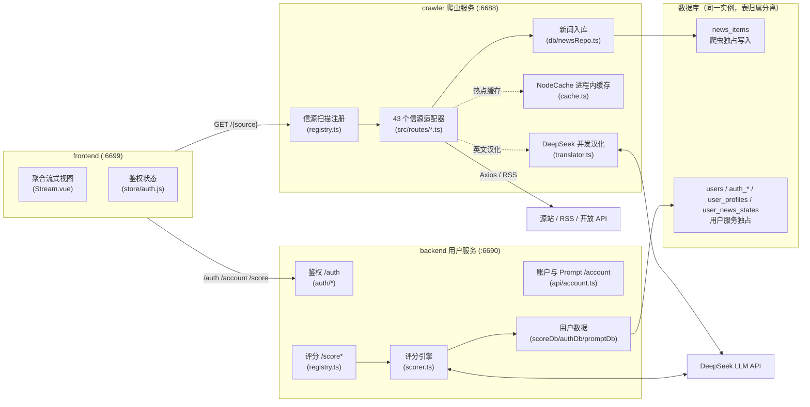
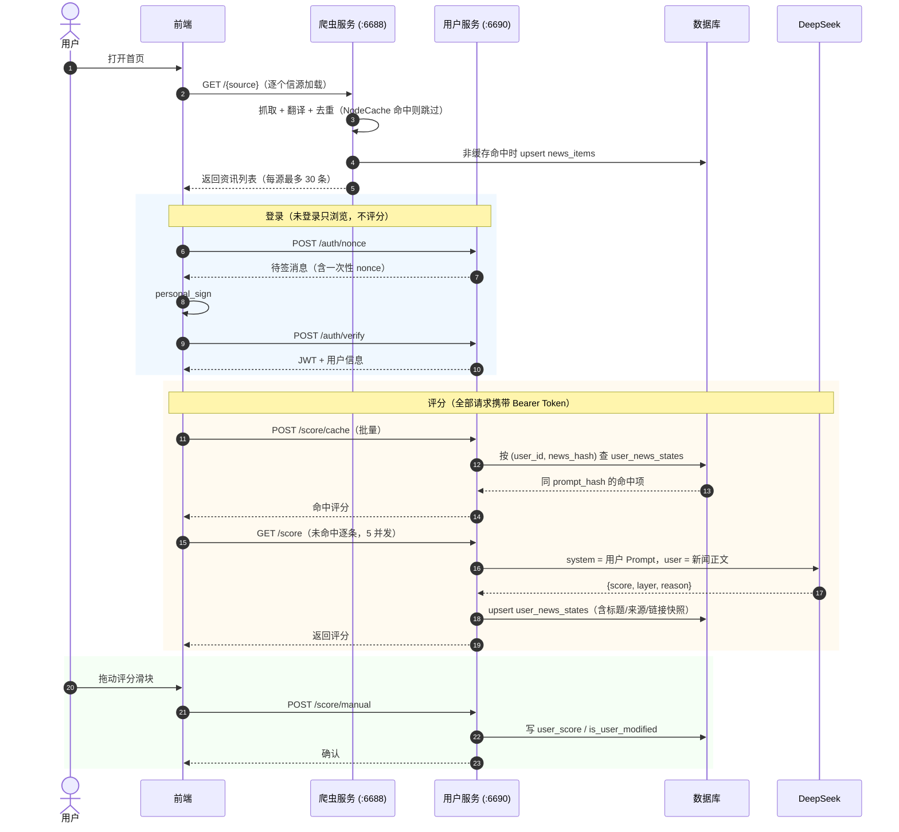

# DailyForYou 三服务 AI 协作与架构指引手册 (AGENTS.md)

> 本文档阐述 DailyForYou 的系统全景架构、crawler / backend / frontend 三者的职责边界与数据流向，并提供修改特定功能模块时的**精准代码路径指引**与**核心编码规范**。

---

## 目录
1. [项目使命与全局定位](#1-项目使命与全局定位)
2. [技术栈与环境要求](#2-技术栈与环境要求)
3. [整体架构与流水线数据流向](#3-整体架构与流水线数据流向)
4. [项目目录结构全景剖析](#4-项目目录结构全景剖析)
5. [AI 修改特定模块的路径指引 (Roadmap for AI)](#5-ai-修改特定模块的路径指引-roadmap-for-ai)
   - [场景 A：新增或修改资讯爬虫 / 数据源](#场景-a新增或修改资讯爬虫--数据源)
   - [场景 B：调优 AI 评分漏斗规则与 Prompt](#场景-b调优-ai-评分漏斗规则与-prompt)
   - [场景 C：扩展 SQLite 数据库字段与持久化结构](#场景-c扩展-sqlite-数据库字段与持久化结构)
   - [场景 D：修改或增强前端信息流交互 (Stream View)](#场景-d修改或增强前端信息流交互-stream-view)
   - [场景 E：国际化与信源批量并发汉化 (Translator)](#场景-e国际化与信源批量并发汉化-translator)
   - [场景 F：修改经典卡片看板 (Board View) 或全局设置](#场景-f修改经典卡片看板-board-view-或全局设置)
   - [场景 G：鉴权、多用户与每用户 Prompt](#场景-g鉴权多用户与每用户-prompt)
6. [AI 代理开发“黄金铁律”与避坑指南 (Gotchas)](#6-ai-代理开发黄金铁律与避坑指南-gotchas)
7. [本地常用命令与接口调试清单](#7-本地常用命令与接口调试清单)

---

## 1. 项目使命与全局定位

DailyForYou 从传统单调的“热榜聚合页面”彻底演化为**面向工程师、投资人与深度思考者的高信噪比实时情报中枢**。

项目由三个平级目录组成，职责严格分离：
- **`crawler/` (爬虫服务，:6688)**：基于 **Hono v4 + DeepSeek AI + Node.js 22 原生 `node:sqlite`**。只负责抓取信源、翻译英文资讯、把结果写入 `news_items`；**不处理用户、不做评分**。
- **`backend/` (用户服务，:6690)**：只负责钱包登录、用户配置、评分、Prompt 管理与已读同步；**不抓取、不翻译、不写入新闻正文**，仅在 `user_news_states` 里保存最小索引字段（来源/标题/链接）。
- **`frontend/` (前端，:6699)**：基于 **Vue 3 + Vite + Naive UI + Pinia** 的看板，榜单请求走爬虫，账户与评分请求走用户服务。

### 核心业务能力
1. **深度 AI 降噪**：采用严苛的五层漏斗（L1~L5 色阶体系，0~100 分），直接识别高能破坏性技术变动与宏观经济决议，压制营销口水。
2. **毫秒级持久化缓存**：基于 Node 22 原生内置 SQLite，无需编译本地 C++ 驱动，基于 MD5 指纹实现一次打分、永久复用。
3. **人机协同 (Human-in-the-Loop)**：前端悬浮滑块支持用户一键手动修正打分，自动记录修正数据，为后续私有化模型/Prompt 校准沉淀样本。
4. **全网已读同步与 Inbox-Zero**：浏览与点击状态沉淀至后端 SQLite，支持“隐藏已读”，实现一键清空全网残留噪声。

---

## 2. 技术栈与环境要求

| 维度 | crawler（爬虫服务） | backend（用户服务） | frontend（前端） |
| :--- | :--- | :--- | :--- |
| **运行时 / 框架** | Node.js >= 22.5、Hono v4、TypeScript 5 | Node.js >= 22.5、Hono v4、TypeScript 5 | Vue 3.5、Vite 4.5、JavaScript |
| **持久化与缓存** | 原生 `node:sqlite` / libSQL、NodeCache（进程内） | 原生 `node:sqlite` / libSQL | Pinia persist、LocalStorage |
| **AI 引擎** | DeepSeek（翻译） | DeepSeek（评分） | - |
| **鉴权** | 无（公开只读） | 钱包签名登录 + JWT | Bearer Token |
| **包管理器** | `pnpm` | `pnpm` | `pnpm` |
| **默认端口** | `6688` | `6690` | `6699` |

---

## 3. 整体架构与流水线数据流向

### 3.1 架构分层图



### 3.2 流式加载、登录与评分时序



---

## 4. 项目目录结构全景剖析

```
DailyForYou/
├── AGENTS.md / README.md / DEPLOYMENT.md
│
├── crawler/                          # 🕷️ 爬虫服务 (:6688) — 只抓取/翻译/入库
│   ├── src/
│   │   ├── index.ts                  # 入口：连库 → 执行 crawler_migrations → 监听
│   │   ├── app.tsx                   # Hono 装配（CORS/压缩/静态资源/首页）
│   │   ├── registry.ts               # 自动扫描信源；去重后调用 newsRepo 入库
│   │   ├── config.ts                 # 端口、缓存 TTL、上游超时、翻译 Key
│   │   ├── types.d.ts                # 榜单相关类型
│   │   ├── db/
│   │   │   ├── client.ts             # libSQL / node:sqlite 连接与执行器
│   │   │   ├── migrations.ts         # crawler_migrations 账本（仅 news_items）
│   │   │   └── newsRepo.ts           # 批量 upsert 新闻（含翻译后的标题摘要）
│   │   ├── routes/                   # 43 个信源适配器（自动扫描装载）
│   │   ├── utils/                    # cache/getData/translator/getToken/logger...
│   │   └── views/                    # 服务端首页与错误页
│   ├── public/                       # favicon 等静态资源
│   ├── scripts/                      # 运维脚本
│   ├── Dockerfile / docker-compose.yml
│   └── .env / .env.example
│
├── backend/                          # 👤 用户服务 (:6690) — 只处理用户/评分/Prompt
│   ├── src/
│   │   ├── index.ts                  # 入口：连库 → 执行 user_migrations → 监听
│   │   ├── app.tsx                   # 纯 JSON API（404/500 也返回 JSON）
│   │   ├── registry.ts               # /auth、/account、/score*（无信源扫描）
│   │   ├── config.ts                 # 端口、鉴权、Prompt 与限流配置
│   │   ├── types.d.ts                # 评分与鉴权类型
│   │   ├── auth/                     # message/jwt/middleware/providers/index
│   │   ├── api/account.ts            # 账户信息、Prompt 读写与试跑
│   │   ├── db/client.ts
│   │   └── utils/
│   │       ├── migrations.ts         # user_migrations 账本
│   │       ├── scoreDb.ts            # user_news_states（单表，含索引字段）
│   │       ├── scorer.ts             # DeepSeek 评分引擎
│   │       ├── scorePrompt.ts        # 默认 Prompt 与消息组装
│   │       ├── promptDb.ts           # 每用户 Prompt（含 60s 进程内缓存）
│   │       ├── authDb.ts             # 用户/身份/nonce
│   │       └── rateLimit.ts          # 进程内限流
│   ├── scripts/                      # backup-scores / login-e2e / rollback
│   ├── Dockerfile / docker-compose.yml
│   └── .env / .env.example
│
├── frontend/                         # 💻 前端 (:6699)
│   ├── public/                       # logo、favicon、sw.js
│   ├── src/
│   │   ├── api/                      # request.js（用户服务）/ index.js（双 baseURL）
│   │   ├── store/                    # index.js（设置）/ auth.js（登录态）
│   │   ├── components/Auth/          # LoginModal、AccountEntry
│   │   ├── views/Stream.vue          # 聚合流
│   │   ├── views/Account.vue         # 账户与 Prompt
│   │   └── ...
│   └── .env / .env.example           # VITE_FEED_API / VITE_GLOBAL_API
│
└── docs/                             # 视觉资产
```

---

## 5. AI 修改特定模块的路径指引 (Roadmap for AI)

当 AI 代理被要求执行某一类具体需求时，请严格参考下述路径与规范推进：

### 场景 A：新增或修改资讯爬虫 / 数据源

1. **在爬虫服务实现适配器**
   - 路径：`crawler/src/routes/<sourceName>.ts`
   - 契约：`export const handleRoute = async (c: ListContext, noCache: boolean): Promise<RouterData>`
   - 抓取：`import { get, post } from "../utils/getData.js"`（自带 NodeCache 与请求头兜底）
   - 解析：JSON 直接用泛型；HTML 用 `cheerio`；RSS 用 `../utils/parseRSS.js`
   - 返回：`RouterData.data` 为 `ListItem[]`，至少包含 `id/title/url`
2. **自动注册**：`crawler/src/registry.ts` 的 `findTsFiles` 会自动扫描 `routes/`，无需手写 import。
3. **自动入库**：`registry.ts` 在去重后调用 `persistNewsSafely(routeData.title, listData.data)`，把标题/摘要/链接写入 `news_items`（翻译已在适配器内完成）。新增信源无需额外接入代码。
4. **前端登记**：`frontend/src/store/index.js` 的 `defaultNewsArr` 增加 `{ label, name, order, show, params? }`。
5. **前端图标**：`frontend/public/logo/<sourceName>.png`。
6. **参数别名**：`frontend/src/api/index.js` 的 `getHotLists` 已内置 `cls-*`/`jiemian-*`/`reuters-*`/`jin10-*`/`bloomberg-*` 前缀映射；新别名在此补充。

---

### 场景 B：调优 AI 评分规则与 Prompt

1. **默认 Prompt**：`backend/src/utils/scorePrompt.ts`
   - `DEFAULT_SCORE_PROMPT` 为 system 消息全文；`buildScoreMessages()` 负责拼 user 消息。
   - 修改后对所有「未自定义」用户生效；已自定义用户的 Prompt 不受影响。
2. **评分引擎**：`backend/src/utils/scorer.ts`
   - `extractNewsMetadata()` 生成 `newsHash`（`md5(【来源】+【标题】+【摘要】)`）
   - `requestScoreCompletion()` 调用 DeepSeek；`parseScoreResponse()` 负责解析与降级
   - `scoreNewsBatch()` 并发调度；`lookupCachedScoresBatch()` 按 `prompt_hash` 判命中
3. **评分接口**：`backend/src/registry.ts`（`POST /score`、`POST /score/cache`、`GET /score/records`）
4. **用户自定义 Prompt**：`backend/src/api/account.ts` + `backend/src/utils/promptDb.ts`
   - `prompt_hash = md5(prompt)`；改 Prompt 后旧 AI 评分自动失效，手动修正永不失效

---

### 场景 C：扩展数据库字段与持久化结构

数据库是「同一实例、表归属分离」，改表前先确认归属：

| 表 | 归属 | 迁移文件（独立账本） |
| :--- | :--- | :--- |
| `news_items` | crawler | `crawler/src/db/migrations.ts`（`crawler_migrations`） |
| `users` / `auth_*` / `user_profiles` / `user_news_states` | backend | `backend/src/utils/migrations.ts`（`user_migrations`） |

规则：
1. 只允许通过迁移追加版本，禁止手写 `ALTER TABLE` 或直接改线上表。
2. 新增字段后同步更新 `backend/src/utils/scoreDb.ts` 的 `NewsScoreRow` 与参数接口。
3. **用户服务不得写入 `news_items`**；它只保存 `user_news_states` 里的最小索引字段（来源/标题/链接）。
4. 前端消费新字段：`frontend/src/components/Stream/composables/useStreamScoring.js`。

---

### 场景 D：修改或增强前端信息流交互 (Stream View)

Stream View 是 DailyForYou 最核心的沉浸式情报瀑布流，各模块职责划分明确：

| 功能诉求 | 目标修改文件 | 关键函数 / 变量 |
| :--- | :--- | :--- |
| **整体信息流聚合与排序** | `frontend/src/views/Stream.vue` | `allArticles` (评分降序、去重、对象引用复用)<br/>`displayedArticles` (过滤已读)<br/>`streamStats` (单次遍历统计) |
| **单条新闻卡片视觉与排版** | `frontend/src/components/Stream/StreamArticleItem.vue` | 标题字号、信源 Tag、热度标签、已读灰显样式、评分理由 |
| **评分徽章与微调滑块** | `frontend/src/components/Stream/StreamScoreBadge.vue` | 悬浮 Popover、`n-slider` 滑块、`commitManualScore` 提交事件 |
| **顶部工具栏、筛选与统计** | `frontend/src/components/Stream/StreamHeader.vue` | 搜索输入框、隐藏已读开关、刷新按钮、统计数字展示 |
| **多信源并发抓取调度** | `frontend/src/components/Stream/composables/useStreamSources.js` | `fetchAllSources()`、各信源加载进度计数 |
| **评分队列、缓存速查与帧缓冲** | `frontend/src/components/Stream/composables/useStreamScoring.js` | `queryCachedScoresBatch()` (毫秒级先查)<br/>`scoreQueue` (工作队列并发)<br/>`flushPendingScores()` (防抖刷入视图) |
| **已读状态追踪与后端同步** | `frontend/src/components/Stream/composables/useStreamReadStatus.js` | `initReadObserver()` (交叉观察器视口检测)<br/>`markAsRead()`<br/>`syncReadStatusToBackend()` |
| **色彩与层级工具函数** | `frontend/src/components/Stream/utils/scoreUtils.js` | `getLayerByScore()`、`getScoreColor()` |

---

### 场景 E：国际化与信源批量并发汉化 (Translator)

1. **翻译引擎核心逻辑**：
   - 目标路径：`crawler/src/utils/translator.ts`。
   - 核心函数：`translateTitlesBatch(items, targetLang = "zh")`。
   - 特性：
     - 采用 **3 条资讯打包一次 DeepSeek 调用** 的策略，在保证语境连贯的同时显著降低网络 RTT。
     - 内置内存级哈希缓存，避免相同标题重复消耗翻译 Token。
2. **在特定信源中集成翻译**：
   - 参考实现：`crawler/src/routes/bloomberg.ts` 或 `crawler/src/routes/reuters.ts`。
   - 模式：拉取英文数据后，提取标题列表送入 `translateTitlesBatch`，将汉化后的文本覆写至 `title`，原英文标题存入 `desc` 或备注中。

---

### 场景 F：修改经典卡片看板 (Board View) 或全局设置

1. **多列卡片组件**：
   - 目标路径：`frontend/src/components/HotList.vue`。
   - 控制单卡片数据抓取、倒计时刷新、滚动高度及展开折叠。
2. **看板主页布局**：
   - 目标路径：`frontend/src/views/Home.vue`。
   - 基于 Naive UI Grid 实现响应式栅格布局（手机端 1 列，PC 端自适应 2~4 列）。
3. **个性化配置中心**：
   - 目标路径：`frontend/src/views/Setting.vue`。
   - 支持使用 `vuedraggable` 对所有信源进行上下拖拽排序、显隐切换、字号设置与外链打开策略配置。

### 场景 G：鉴权、多用户与每用户 Prompt

1. **登录链路（MetaMask，SIWE 风格）**：
   - 后端目录：`backend/src/auth/`（`message.ts` 生成消息、`jwt.ts` 签发校验、`middleware.ts` 守卫、`providers.ts` 渠道抽象）。
   - 流程：`POST /auth/nonce` 拿服务端生成的消息 → 前端 `personal_sign` → `POST /auth/verify` → 用 `viem` 的 `verifyMessage` 验签 → 签发 JWT。
   - 客户端**不得自行拼接签名消息**，必须原样签名服务端返回的 `message`（服务端逐字比对并校验 nonce 一次性消费）。
   - 微信扫码 / 手机号为预留渠道：`providers.ts` 中 `enabled: false`，路由直接返回 501；接入时只需实现 provider 并置 `enabled: true`，前端与路由无需改动。

2. **鉴权中间件挂载（顺序敏感）**：
   - `registry.ts` 顶部：`app.use("/score", requireAuth)` 与 `app.use("/score/*", requireAuth)`。
   - **这两行必须位于所有 `/score` 处理器之前**，Hono 的中间件只对之后注册的路由生效；`/score/*` 已能匹配 `/score`，重复注册由中间件首行的幂等判断消除。
   - 401 一律 `c.json({ code: 401, needLogin: true })` 返回，**不要 throw**；用户服务的 `onError` 虽已改为 JSON，但中间件内直接返回更可控。

3. **数据模型（表归属分离，迁移账本独立）**：
   - 用户服务独占：`users` / `auth_identities` / `auth_nonces` / `user_profiles` / `user_news_states`（账本 `user_migrations`）。
   - 爬虫独占：`news_items`（账本 `crawler_migrations`），用户服务运行期不读取该表。
   - `user_news_states` 额外保存 `source/title/url` 三个索引字段，评分与记录展示不再依赖新闻表。
   - 旧表 `news_scores` 属于历史遗留，只读保留，不再写入。

4. **每用户 Prompt 与缓存命中**：
   - `user_profiles.score_prompt` 为 system 消息全文，`prompt_hash = md5(prompt)`。
   - 评分缓存命中条件：`ai_score >= 0 && prompt_hash === 当前用户 promptHash`，或 `is_user_modified = 1`（手动修正永不因改 Prompt 失效）。
   - 消息体为 system（Prompt）+ user（`【待评分新闻】：\n正文`），由 `buildScoreMessages` 统一组装。

5. **多用户安全约定**：
   - 任何用户态查询都必须带 `user_id`；按主键更新必须 `WHERE id = ? AND user_id = ?`，避免越权改到他人记录。
   - 前端已读集合带 `readNewsKeysOwner`，切换账号时必须清空，禁止跨账号复用本地已读状态。

---

## 6. AI 代理开发“黄金铁律”与避坑指南 (Gotchas)

在为本项目编写或修改代码时，AI 代理**必须严格遵守**以下规则：

### 🛑 铁律一：严禁引入破坏性的外部 SQLite 编译依赖
- 后端已采用 **Node.js 22 原生内置** 的 `import { DatabaseSync } from "node:sqlite"`。
- **绝对不要** 安装 `better-sqlite3`、`sqlite3` 等需要 `node-gyp` 和本地 C++ 编译器的包，否则会导致跨平台容器与轻量环境构建失败！

### 🛑 铁律二：尊重爬虫的自动路由扫描机制
- 新增或调整爬虫时，只维护 `crawler/src/routes/` 下的单一文件。
- 不要为**信源**在 `crawler/src/app.tsx` 或 `crawler/src/registry.ts` 中手动静态编写 `app.route("/xxx", xxxRouter)`，保持目录发现架构的纯粹。
- **用户服务不是信源**：`backend/src/auth/` 与 `backend/src/api/account.ts` 的路由在 `backend/src/registry.ts` 顶部集中挂载，且必须早于所有 `/score` 处理器（Hono 中间件只对之后注册的路由生效）。

### 🛑 铁律三：维护 newsHash 文本指纹的一致性
- 指纹算法：`md5(formattedText)`，`formattedText` 由 `【来源】/【标题】/【摘要】` 三段拼接（**url 不参与哈希**，摘要截断 500 字）。
- 两处实现必须保持一致：`crawler/src/utils/newsText.ts`（入库用）与 `backend/src/utils/scorer.ts` 的 `extractNewsMetadata`（评分用）。
- 但**两者不再是同一个键**：`news_items.news_hash` 由爬虫生成，`user_news_states.news_hash` 由用户服务按前端请求计算。用户服务运行期**不读取** `news_items`，只在自己的表里保存来源/标题/链接快照。

### 🛑 铁律四：警惕流式长列表的高频渲染性能
- 前端 `/stream` 模式下存在数百至上千条聚合条目。
- **不要** 在评分返回每条单项时直接触发全量数组深拷贝或 `Array.sort()`。
- 必须遵循当前已建立的 **批量帧缓冲合并模式 (`flushPendingScores`)**，并在 `allArticles` 的 computed 中基于 `prevObj` 进行对象引用复用，杜绝全列表子组件无意义的 DOM 重绘。

### 🛑 铁律五：爬虫数据格式严格归一化
- 所有 `crawler/src/routes/*.ts` 必须返回规范的 `RouterData`，条目中的 `url` 必须为有效跳转链接。
- 若源站使用了防盗链图片或特殊 Cookie，需在 `headers` 中妥善设置 `Referer` 与 `User-Agent`。

### 🛑 铁律六：严守服务边界
- **爬虫不得**读写用户表（`users` / `auth_*` / `user_profiles` / `user_news_states`），也不得调用评分或鉴权逻辑。
- **用户服务不得**抓取源站、调用翻译、写入 `news_items`；评分所需的标题/摘要一律来自前端请求体。
- 两边共用一个数据库实例，但迁移账本独立（`crawler_migrations` / `user_migrations`），新增表必须归属明确。
- 任何跨服务的数据需求，优先通过前端已有的请求参数传递，不要在用户服务里加"反查新闻表"的便捷分支。

---

## 7. 本地常用命令与接口调试清单

### 7.1 开发与构建

```bash
# 爬虫服务 (:6688) —— 抓取、翻译、入库
cd crawler && pnpm install && pnpm dev

# 用户服务 (:6690) —— 登录、评分、Prompt
cd backend && pnpm install && pnpm dev

# 前端 (:6699)
cd frontend && pnpm install && pnpm dev

# 类型检查与构建（各自目录）
pnpm build
```

### 7.2 接口调试

```bash
# 信源总览（爬虫）
curl http://localhost:6688/all

# 抓取财联社（爬虫，force 刷新会触发入库）
curl "http://localhost:6688/cls?limit=10&cache=false"

# 用户服务：未登录访问评分接口应返回 401
curl -i http://localhost:6690/score

# 申请登录挑战（把地址换成你的钱包地址）
curl -X POST http://localhost:6690/auth/nonce \
  -H "Content-Type: application/json" \
  -d '{"address":"0x0000000000000000000000000000000000000000","chainId":1}'

# 携带令牌评分
curl -X POST http://localhost:6690/score \
  -H "Content-Type: application/json" \
  -H "Authorization: Bearer <token>" \
  -d '{"title":"DeepSeek 发布新模型","desc":"推理成本下降","source":"v2ex"}'

# 一键跑通登录 + 评分 + 跨用户隔离（临时钱包，自动清理）
cd backend && node scripts/login-e2e.mjs
```
