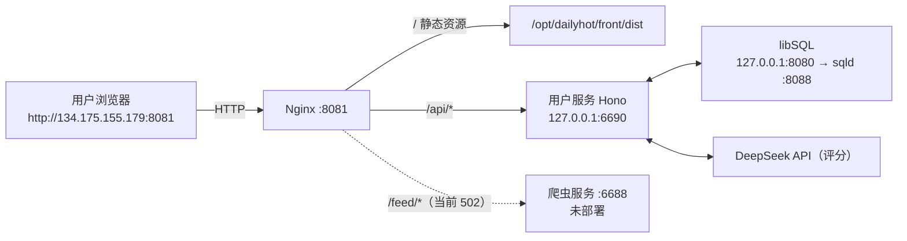
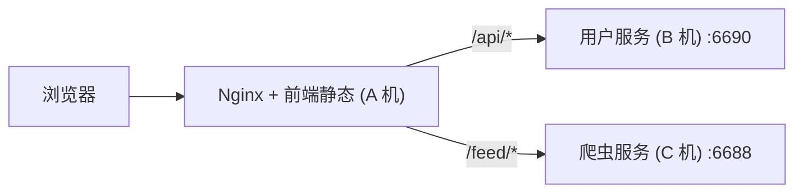

# DailyForYou 服务器部署与更新运维手册 (DEPLOYMENT.md)

本文档记录 DailyForYou 各服务在 `134.175.155.179` 上的**实际**部署布局、更新流程与运维操作。

> **当前部署状态**：前端（静态）+ 用户服务（`backend` :6690）已上线；
> 爬虫（`crawler` :6688）**尚未部署**，因此站点首页榜单为空、`/feed/*` 返回 502，登录与账户功能不受影响。

---

## 1. 架构拓扑与运行环境

### 1.1 基本信息
- **公网 IP**：`134.175.155.179`
- **SSH 登录**：`ssh root@134.175.155.179`
- **Web 访问入口**：👉 **`http://134.175.155.179:8081`**
- **安全组放行**：仅需 `8081`（站点）与 `8080`（libSQL，既有）；`6690` / `6688` 一律不对外
- **运行时环境**：Node.js `v22.22.1`、Nginx、pnpm `12.14.0`、PM2 `7.0.4`（systemd 托管）

### 1.2 端口分配（重要）

| 端口 | 用途 | 监听地址 | 说明 |
| :--- | :--- | :--- | :--- |
| `80` | 既有业务（python / uvicorn） | `0.0.0.0` | **不可占用** |
| `8080` | libSQL（Nginx 反代 sqld + Bearer 校验） | `0.0.0.0` | 既有服务，勿改 |
| `8088` | sqld 本体 | `127.0.0.1` | 仅本机 |
| `8081` | **DailyForYou 站点（本手册）** | `0.0.0.0` | Nginx 新站点 |
| `6690` | 用户服务 `backend` | `127.0.0.1` | 仅 Nginx 反代 |
| `6688` | 爬虫 `crawler`（未部署） | — | 预留 |

### 1.3 架构拓扑图



> **架构要点**：
> 1. **同域反代**：前端与用户服务同域，`/api` 反代避免 CORS，令牌不跨域。
> 2. **爬虫可换机器**：`/feed` 的上游是独立的 Nginx `upstream` 块。爬虫部署在本机就写 `127.0.0.1:6688`，
>    部署在别的机器就写 `<IP>:6688`——**只改一行并 reload，前端无需重新构建**。
> 3. **安全隔离**：用户服务只监听 `127.0.0.1`，公网只能经 Nginx 进入。

---

## 2. 服务器目录规划

```
/opt/dailyhot/
├── back/                              # 用户服务 (:6690)
│   ├── .env                           # 生产环境变量（权限 600）
│   ├── dist/                          # tsc 编译产物，PM2 直接运行 dist/index.js
│   ├── node_modules/                  # pnpm install --prod
│   ├── scripts/                       # login-e2e / backup-scores / rollback
│   ├── logs/                          # PM2 与 winston 日志
│   ├── data/                          # 仅本地 SQLite 模式使用
│   ├── ecosystem.config.cjs           # PM2：dailyhot-back
│   └── package.json / pnpm-lock.yaml
└── front/
    └── dist/                          # Vite 构建产物，Nginx 直接托管
```

- **Nginx 站点配置**：`/etc/nginx/conf.d/dailyforyou.conf`（监听 8081）
- **既有 libSQL 配置**：`/etc/nginx/conf.d/sqld.conf`（监听 8080，**不要动**）
- **PM2 进程**：`dailyhot-back`，由 systemd `pm2-root.service` 托管，开机自启
- **前端构建变量**：`frontend/.env.production` → `VITE_GLOBAL_API="/api"`、`VITE_FEED_API="/feed"`

---

## 3. 本地代码更新推送到云端

> 命令在**本地项目根目录**执行（macOS / Linux；Windows 用 WSL 或 Git Bash）。
> 核心原则：**只覆盖代码产物，绝不覆盖服务端 `.env`、`logs/`、`data/`。**

### 场景 A：仅更新用户服务

```bash
cd backend
pnpm build

rsync -az dist package.json pnpm-lock.yaml ecosystem.config.cjs \
  root@134.175.155.179:/opt/dailyhot/back/

# 仅当 package.json / lock 有变动时才需要
ssh root@134.175.155.179 "cd /opt/dailyhot/back && pnpm install --prod --frozen-lockfile"

ssh root@134.175.155.179 "pm2 restart dailyhot-back --update-env"
```

验证：

```bash
curl -s -o /dev/null -w "%{http_code}\n" http://134.175.155.179:8081/api/auth/providers   # 200
curl -s -o /dev/null -w "%{http_code}\n" http://134.175.155.179:8081/api/score            # 401
```

### 场景 B：仅更新前端

```bash
cd frontend
pnpm build      # 自动读取 .env.production（/api、/feed）

rsync -az --delete dist/ root@134.175.155.179:/opt/dailyhot/front/dist/
```

> 前端是纯静态，无需重启进程。若浏览器命中 Service Worker 缓存，强制刷新即可。

### 场景 C：一次更新前端 + 用户服务

```bash
cd backend && pnpm build && rsync -az dist package.json pnpm-lock.yaml ecosystem.config.cjs root@134.175.155.179:/opt/dailyhot/back/ && cd ..
cd frontend && pnpm build && rsync -az --delete dist/ root@134.175.155.179:/opt/dailyhot/front/dist/ && cd ..
ssh root@134.175.155.179 "pm2 restart dailyhot-back --update-env"
```

### 场景 D：首次全新部署（换机时照此重来）

```bash
# 1. 目录
ssh root@134.175.155.179 "mkdir -p /opt/dailyhot/back/{logs,data} /opt/dailyhot/front"

# 2. 用户服务
cd backend && pnpm build
rsync -az dist package.json pnpm-lock.yaml ecosystem.config.cjs scripts \
  root@134.175.155.179:/opt/dailyhot/back/
scp .env root@134.175.155.179:/opt/dailyhot/back/.env
ssh root@134.175.155.179 "chmod 600 /opt/dailyhot/back/.env && cd /opt/dailyhot/back && \
  pnpm install --prod --frozen-lockfile && pm2 start ecosystem.config.cjs && pm2 save"

# 3. 前端
cd ../frontend && pnpm build
rsync -az dist/ root@134.175.155.179:/opt/dailyhot/front/dist/

# 4. Nginx（配置见 4.2）后 reload
ssh root@134.175.155.179 "nginx -t && nginx -s reload"
```

> 生产 `.env` 与本地 `.env` 的差异：
> `HOST=127.0.0.1`、`LIBSQL_URL=http://127.0.0.1:8080`、
> `AUTH_DOMAIN=134.175.155.179:8081`、`AUTH_URI=http://134.175.155.179:8081`。
> `HOST` 不能留默认 `0.0.0.0`，否则 6690 会直接暴露在公网网卡上。

---

## 4. 云端常用运维命令清单

登录服务器：`ssh root@134.175.155.179`

### 4.1 服务管理 (PM2)
```bash
# 进程状态（dailyhot-back 应始终 online）
pm2 status

# 实时日志 / 最近 50 条
pm2 logs dailyhot-back
pm2 logs dailyhot-back --lines 50 --nostream

# 重启（改了代码或 .env 后用 --update-env 让新环境变量生效）
pm2 restart dailyhot-back --update-env

# 停止 / 启动
pm2 stop dailyhot-back
pm2 start /opt/dailyhot/back/ecosystem.config.cjs

# 保存当前进程列表（重启服务器后自动恢复），并确认 systemd 托管
pm2 save
systemctl is-enabled pm2-root && systemctl is-active pm2-root

# 爬虫服务部署后（当前未部署）
# pm2 logs dailyhot-crawler
# pm2 restart dailyhot-crawler
```

### 4.2 Web 服务器管理 (Nginx)
```bash
# 改完配置先测语法
nginx -t

# 平滑重载（不中断连接）
nginx -s reload

# 站点配置与既有 libSQL 配置
ls -l /etc/nginx/conf.d/dailyforyou.conf      # 本项目，监听 8081
ls -l /etc/nginx/conf.d/sqld.conf             # 既有 libSQL，监听 8080，勿改

# 查看 8081 是否在监听
ss -lntp | grep 8081

# 错误日志
tail -f /var/log/nginx/error.log
```

> **切换爬虫机器**：编辑 `dailyforyou.conf` 里的 `upstream dailyforyou_crawler { server ... }`，
> 改成爬虫实际地址后 `nginx -t && nginx -s reload`。前端不用重新构建。

### 4.3 数据库检查与备份

生产使用本机 libSQL（`LIBSQL_URL=http://127.0.0.1:8080` → Nginx 反代 → sqld `127.0.0.1:8088`），
**不是**本地 SQLite 文件；sqld 数据目录 `/var/lib/sqld` 由既有服务管理，不要手动改文件。

```bash
# 连通性（8080 需要 Bearer 令牌，取 .env 里的 LIBSQL_AUTH_TOKEN）
curl -s -H "Authorization: Bearer <LIBSQL_AUTH_TOKEN>" http://127.0.0.1:8080/health

# 表规模速查
cd /opt/dailyhot/back && node --input-type=module -e "
import fs from 'node:fs';
const env = fs.readFileSync('.env','utf8');
const pick = (k) => { const m = new RegExp('^'+k+'=(.*)\$','m').exec(env); return m ? m[1].replace(/^\"|\"\$/g,'') : ''; };
const { createClient } = await import('@libsql/client');
const c = createClient({ url: pick('LIBSQL_URL'), authToken: pick('LIBSQL_AUTH_TOKEN') });
for (const t of ['users','auth_identities','user_news_states']) {
  console.log(t, (await c.execute('select count(*) c from '+t)).rows[0].c);
}"

# 历史数据备份（导出旧表为 JSON，含行数与 md5）
node scripts/backup-scores.mjs
```

---

## 5. 核心铁律与避坑事项 (Gotchas)

1. **切勿覆盖云端 `.env` 文件**：
   生产密钥（`DEEPSEEK_API_KEY`、`AUTH_JWT_SECRET`、`LIBSQL_AUTH_TOKEN`）只保存在 `/opt/dailyhot/back/.env`（权限 600）。
   推送时只 rsync `dist` / `package.json` / `pnpm-lock.yaml` / `ecosystem.config.cjs`，
   严禁 `scp -r backend/*` 这类全量覆盖，否则会冲掉生产密钥。生产与本地 `.env` 的差异见第 3 章末尾。
2. **不要引入外部 SQLite 驱动**：
   项目使用 Node.js 22 原生 `node:sqlite`（`DatabaseSync`），不要在服务器执行 `pnpm add better-sqlite3` 或 `sqlite3`。
3. **端口不可乱占**：
   80 是既有 python 业务、8080 是既有 libSQL 反代；本项目站点固定 **8081**（见 1.2 端口分配）。

---

## 6. 多用户与钱包登录：上线前置条件

### 6.1 新增环境变量（写入云端 `.env`）

| 变量 | 说明 |
| :--- | :--- |
| `AUTH_JWT_SECRET` | **必填**。`openssl rand -hex 32` 生成；非 development 环境缺失会直接启动失败 |
| `DEFAULT_USER_ADDRESS` | 承接历史数据的钱包地址（小写）。设置后重启即绑定到默认账户 |
| `AUTH_DOMAIN` / `AUTH_URI` | 登录消息中的域名与 URI，建议填真实访问地址，避免钱包展示的域名异常 |
| `AUTH_JWT_TTL` | 登录令牌有效期，默认 `604800`（7 天） |
| `AUTH_NONCE_TTL` | 签名挑战有效期，默认 `300` 秒 |
| `SCORE_RATE_LIMIT_PER_MIN` | 每用户每分钟评分请求上限，默认 `240`，作为滥用防护 |
| `SCORE_PROMPT_MAX_LENGTH` | 用户自定义 Prompt 长度上限，默认 `20000` |

### 6.2 首次启动会执行数据库迁移（不可逆，先备份）

两个服务各自执行独立迁移，互不写入对方的表：

- **爬虫**：账本 `crawler_migrations`，创建 `news_items`（已存在则跳过）。
- **用户服务**：账本 `user_migrations`，创建 `users` / `auth_identities` / `auth_nonces` / `user_profiles` / `user_news_states`；其中 `u003` 会补齐 `source/title/url` 三列，并从 `news_items` **一次性**回填历史索引（仅迁移期读取，运行期不再依赖）。

迁移前务必备份用户数据：

```bash
cd /opt/dailyhot/back
node scripts/backup-scores.mjs          # 导出 JSON 到 data/backup/，含行数与 md5
```

迁移后验证：

```bash
node --input-type=module -e "
import('@libsql/client').then(async ({createClient})=>{
  const c=createClient({url:process.env.LIBSQL_URL,authToken:process.env.LIBSQL_AUTH_TOKEN});
  for (const sql of [
    'select count(*) c from user_news_states',
    \"select count(*) c from user_news_states where title != ''\",
    'select version, note from user_migrations'
  ]) console.log(sql, JSON.stringify((await c.execute(sql)).rows));
});"
```

> 若使用本地 SQLite（`LIBSQL_URL` 为空），两个服务各自使用 `data/users.sqlite` 与 `data/news.sqlite`，备份与迁移同样生效。

### 6.3 必须启用 HTTPS

登录令牌与钱包签名消息在明文 HTTP 链路上可被窃取。上线前必须在 Nginx 配置 TLS（Let's Encrypt / 云厂商证书均可），
并确保 `AUTH_URI` 使用 `https://`。仅内网或 VPN 访问时才可暂时保留 HTTP。

### 6.5 多服务更新顺序

拆分后发布顺序建议：**先爬虫，再用户服务，最后前端**。

```bash
# 1. 爬虫（部署后才有这一步）
cd crawler && pnpm build && rsync -az dist package.json pnpm-lock.yaml ecosystem.config.cjs \
  root@134.175.155.179:/opt/dailyhot/crawler/
ssh root@134.175.155.179 "pm2 restart dailyhot-crawler --update-env"

# 2. 用户服务
cd ../backend && pnpm build && rsync -az dist package.json pnpm-lock.yaml ecosystem.config.cjs \
  root@134.175.155.179:/opt/dailyhot/back/
ssh root@134.175.155.179 "pm2 restart dailyhot-back --update-env"

# 3. 前端
cd ../frontend && pnpm build && rsync -az --delete dist/ \
  root@134.175.155.179:/opt/dailyhot/front/dist/
```

> 表归属分离，任一服务单独重启都不会丢数据。用户服务重启期间登录与评分短暂不可用，
> 已加载的页面与爬虫不受影响。

### 6.6 回滚策略

- 迁移失败会自动回滚事务，迁移账本不写入记录，修复原因后重启即重跑。
- 两个账本独立：`crawler_migrations`（爬虫）与 `user_migrations`（用户服务），升级互不影响。
- 需要退回旧版本：`news_scores` 未被修改，直接回滚代码与 `dist` 即可；期间新产生的评分可用 `scripts/rollback-user-states.mjs` 回灌到旧表。

---

## 7. 爬虫与用户服务分机部署

两个服务之间**没有任何直接调用**：爬虫只写自己的新闻库，用户服务只读写自己的用户库，前端分别请求两者。因此完全可以跑在不同服务器，甚至不同地域。

> **当前实际**：前端与用户服务同机（`134.175.155.179`），爬虫未部署，
> `/feed` 上游暂指 `127.0.0.1:6688`，因此首页榜单为空、接口返回 502。部署爬虫后按下文调整即可。

### 7.1 两种拓扑

**A. 单入口（推荐）**：前端与 Nginx 在一台，Nginx 反代到两台后端。



前端构建变量：

```
VITE_GLOBAL_API="/api"
VITE_FEED_API="/feed"
```

Nginx 片段（注意 `proxy_pass` 末尾斜杠，用于剥掉 `/api` 与 `/feed` 前缀）：

```nginx
location /api/ {
    proxy_pass http://B_SERVER_IP:6690/;
    proxy_set_header Host $host;
    proxy_set_header X-Forwarded-For $proxy_add_x_forwarded_for;
    proxy_set_header X-Forwarded-Proto $scheme;
}

location /feed/ {
    proxy_pass http://C_SERVER_IP:6688/;
    proxy_set_header X-Forwarded-For $proxy_add_x_forwarded_for;
}
```

**B. 直连**：前端直接配置两个公网地址。

```
VITE_GLOBAL_API="https://api.example.com"
VITE_FEED_API="https://feed.example.com"
```

此时两个服务都要处理跨域。默认 `ALLOWED_DOMAIN="*"` 已放行，生产建议收紧到前端域名。

### 7.2 两台服务器的环境变量

**爬虫机**：`PORT=6688`、`LIBSQL_URL`（或留空用本地 `data/news.sqlite`）、`DEEPSEEK_API_KEY`（翻译）、`ALLOWED_DOMAIN` / `ALLOWED_HOST`。**不需要任何 `AUTH_*`**。

**用户机**：`PORT=6690`、`HOST=127.0.0.1`（只让本机 Nginx 访问）、自己的 `LIBSQL_URL`（或 `data/users.sqlite`）、`AUTH_JWT_SECRET`（必填，不与爬虫共享）、`DEFAULT_USER_ADDRESS`、`AUTH_URI` / `AUTH_DOMAIN`（指向用户实际访问的域名）、`DEEPSEEK_API_KEY`（评分）。

### 7.3 数据库怎么放

三种组合都支持：

1. **各自本地 SQLite**（最简单）：爬虫 `news.sqlite`、用户 `users.sqlite`，零共享。
2. **共享一个 libSQL**：两边 `LIBSQL_URL` 指向同一地址，表不重叠，互不影响。
3. **各自独立 libSQL**：完全隔离，适合按服务独立扩容与备份。

> 注意：`u003` 迁移的索引回填，只在用户服务自己的库里存在 `news_items` 时执行。如果历史数据原在共享库、之后才拆成独立库，需要先把 `user_news_states` 导出再导入用户库——`source/title/url` 已在列里，导入即可。

### 7.4 必须检查的四件事

1. **HTTPS**：前端是 https 时两个 API 也必须 https，否则浏览器会拦截混合内容。
2. **CORS**：直连模式确认 `ALLOWED_DOMAIN` 覆盖前端域名；同域反代模式不涉及。
3. **时钟**：JWT 与 nonce 依赖服务器时间，两台机器都要开 NTP。
4. **防火墙**：6690 只对 Nginx 或前端网段开放；6688 可公网只读，也可只走内网反代。
