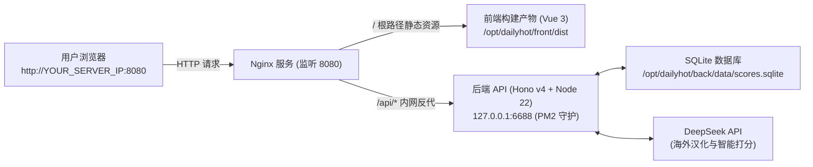

# DailyHot 服务器部署与更新运维手册 (DEPLOYMENT.md)

本文档记录 DailyHot 在远程服务器上的架构布局、日常更新推送流程及常用运维操作。

---

## 1. 架构拓扑与运行环境

### 1.1 基本信息
- **公网 IP**：`YOUR_SERVER_IP`
- **SSH 登录**：`ssh root@YOUR_SERVER_IP`（已配置 SSH 密钥登录）
- **Web 访问入口**：👉 **`http://YOUR_SERVER_IP:8080`**
- **运行时环境**：Node.js `v22.22.1`（原生内置 `node:sqlite` 支持 WAL 高并发）、Nginx `1.28.3`、pnpm `12.14.0`、PM2 `7.0.4`

### 1.2 架构拓扑图



> **架构优势**：
> 1. **避免端口冲突**：服务器 80 端口已被现有业务占用，本项目使用独立的 **8080 端口**。
> 2. **零跨域 (CORS) 限制**：前端 API 请求统一定向至相对路径 `/api`，由 Nginx 内网直转 `127.0.0.1:6688`。
> 3. **安全隔离**：云服务商安全组**无需暴露 6688 端口**，保障底层 API 与 SQLite 数据库安全。

---

## 2. 服务器目录规划

```
/opt/dailyhot/
├── back/                              # 后端主工作区
│   ├── .env                           # 云端环境密钥配置（包含 DEEPSEEK_API_KEY 等，严禁向外泄露）
│   ├── data/                          # SQLite 持久化目录
│   │   ├── scores.sqlite              # 主数据库（AI评分、已读标记等）
│   │   ├── scores.sqlite-wal          # 预写日志文件
│   │   └── scores.sqlite-shm          # 共享内存索引文件
│   ├── dist/                          # 后端 TypeScript 编译后的 JS 文件
│   ├── src/                           # 后端源码镜像
│   ├── ecosystem.config.cjs           # PM2 启动配置文件
│   └── package.json                   # 依赖配置清单
└── front/                             # 前端主工作区
    └── dist/                          # 前端 Vite 打包后的纯静态文件 (由 Nginx 托管)
```

- **Nginx 配置文件**：`/etc/nginx/conf.d/dailyhot.conf`
- **PM2 守护任务名**：`dailyhot-back`（已挂载 systemd 开机自启服务 `pm2-root.service`）

---

## 3. 本地代码更新推送到云端

当您在本地修改了代码或配置后，请按照以下步骤推送至服务器：

### 场景 A：仅更新后端（修改了爬虫、Prompt 规则、路由或数据库逻辑）

在本地项目根目录（或 `back` 目录）的 PowerShell 中执行：

```powershell
# 1. 进入本地后端并编译
cd c:\Users\Lima\WebstormProjects\DailyHot\back
pnpm run build

# 2. 将编译产物与源码增量推送到云端（注意：绝不覆盖服务端的 .env 和 data 目录）
scp -r dist src root@YOUR_SERVER_IP:/opt/dailyhot/back/

# 3. 平滑重启后端 PM2 进程
ssh root@YOUR_SERVER_IP "pm2 restart dailyhot-back"
```

> [!NOTE]
> 如果修改了 `package.json`（新增了第三方 npm 包），需在重启前在服务器安装依赖：  
> `ssh root@YOUR_SERVER_IP "cd /opt/dailyhot/back && pnpm install"`

---

### 场景 B：仅更新前端（修改了 Vue 组件、Pinia 状态、样式或 UI 交互）

在本地项目根目录（或 `front` 目录）的 PowerShell 中执行：

```powershell
# 1. 进入本地前端并打包（已固定 VITE_GLOBAL_API="/api"）
cd c:\Users\Lima\WebstormProjects\DailyHot\front
pnpm run build

# 2. 将 dist 打包、上传并解压到云端前端目录
tar -czf dist.tar.gz dist
scp dist.tar.gz root@YOUR_SERVER_IP:/opt/dailyhot/front/
ssh root@YOUR_SERVER_IP "tar -xzf /opt/dailyhot/front/dist.tar.gz -C /opt/dailyhot/front && rm -f /opt/dailyhot/front/dist.tar.gz"
Remove-Item dist.tar.gz
```

> [!TIP]
> 前端部署无需重启任何进程，解压覆盖后，刷新浏览器页面即可即时看到最新界面！

---

### 场景 C：全栈前后端一键推送更新（推荐）

在项目根目录 `c:\Users\Lima\WebstormProjects\DailyHot` 打开 PowerShell，直接复制粘贴以下一键指令：

```powershell
# 1. 编译并推送后端
cd back; pnpm run build; scp -r dist src root@YOUR_SERVER_IP:/opt/dailyhot/back/

# 2. 编译并推送前端
cd ../front; pnpm run build; tar -czf dist.tar.gz dist; scp dist.tar.gz root@YOUR_SERVER_IP:/opt/dailyhot/front/

# 3. 云端解压前端并重启后端
ssh root@YOUR_SERVER_IP "tar -xzf /opt/dailyhot/front/dist.tar.gz -C /opt/dailyhot/front && rm -f /opt/dailyhot/front/dist.tar.gz && pm2 restart dailyhot-back"
Remove-Item dist.tar.gz
cd ..
```

---

## 4. 云端常用运维命令清单

登录服务器：`ssh root@YOUR_SERVER_IP`

### 4.1 后端服务管理 (PM2)
```bash
# 查看所有后台服务的状态、CPU 与内存占用
pm2 status

# 查看后端实时输出日志（便于排查 AI 打分或信源抓取问题）
pm2 logs dailyhot-back

# 查看最近 50 条日志而不持续追踪
pm2 logs dailyhot-back --lines 50 --nostream

# 重启 / 停止 / 启动后端服务
pm2 restart dailyhot-back
pm2 stop dailyhot-back
pm2 start /opt/dailyhot/back/ecosystem.config.cjs
```

### 4.2 Web 服务器管理 (Nginx)
```bash
# 测试 Nginx 配置语法是否正确
nginx -t

# 平滑重新加载配置
nginx -s reload
# 或者
systemctl reload nginx

# 查看 Nginx 运行状态与错误日志
systemctl status nginx
tail -f /var/log/nginx/error.log
```

### 4.3 数据库检查与备份
```bash
# 检查数据库大小
ls -lh /opt/dailyhot/back/data/

# 快速备份数据库
cp /opt/dailyhot/back/data/scores.sqlite /opt/dailyhot/back/data/scores_backup_$(date +%Y%m%d).sqlite
```

---

## 5. 核心铁律与避坑事项 (Gotchas)

1. **切勿覆盖云端 `.env` 文件**：
   本地 `back/.env` 已被安全清空，生产密钥（`DEEPSEEK_API_KEY`）仅留存于云端 `/opt/dailyhot/back/.env`。推送本地文件时**严禁使用全量覆盖（如 `scp -r back/*`）**，以免冲掉服务器上的生产密钥。
2. **切勿使用破坏性的外部 SQLite 驱动**：
   项目严格采用 Node.js 22 原生内置的 `node:sqlite`（`DatabaseSync`），不要在服务器端执行 `pnpm add better-sqlite3` 或 `sqlite3`。
3. **保持 80 端口与现行服务隔离**：
   服务器 80 端口运行有现有业务，DailyHot 的 Nginx 严禁占用 80 端口，统一监听 **8080 端口**。
