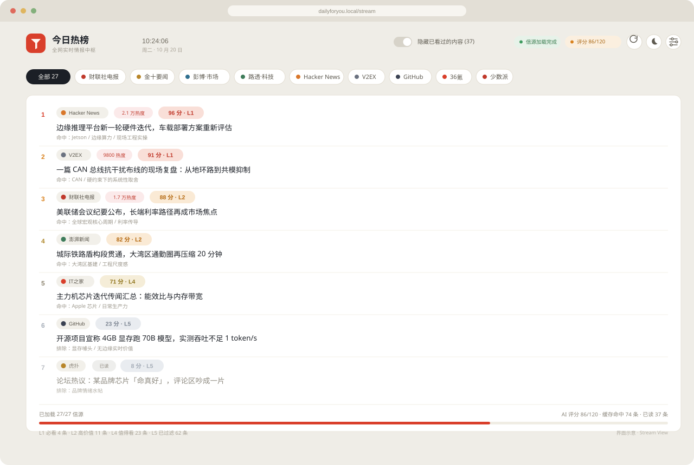

<h1 align="center">DailyForYou</h1>

<div align="center">
  
  <br/><br/>

  
  
  
  
  

  <br/>

  **43 个信源，一条信息流。**<br/>
  先按你的口味排序，再决定什么值得看。

  <sub>One feed. 43 sources. Ranked for you, not for everyone.</sub>
</div>

---

## 先说结论

大多数热榜产品在回答同一个问题：**「现在什么最热？」**

DailyForYou 回答的是另一个问题：**「现在什么值得我读？」**

它把 43 个信源的上千条更新抓回来，去重、把彭博与路透的标题译成中文，再用一套你可以亲手改写的评分规则排序。打开就是最该看的那几条，每条都附一句理由。

> 热度是公共的，优先级是私人的。

没有账号，没有云端画像。评分和已读都存在你自己的数据库里。

## 它和热榜聚合器，不是一个东西

| 维度 | 传统热榜聚合 | DailyForYou |
| :--- | :--- | :--- |
| **排序依据** | 平台热度、发布时间 | 你的职业、技术栈、在推项目与审美偏好 |
| **输出形态** | 一个更长的列表 | 一条 0–100 分的降序情报流 |
| **可解释性** | 无 | 每条附 25 字命中 / 排除理由 |
| **重复内容** | 同一条新闻在多个源反复出现 | 跨信源自动合并，只出现一次 |
| **已读状态** | 每次刷新重新看一遍 | 跨端同步，一键隐藏，Inbox Zero |

**适合**：每天要扫几十个源的人、需要判断技术与宏观信号的人、受够了「热度」的人。

**不适合**：只想看微博热搜第一的人——打开官方客户端更快。

## 界面



<p align="center"><sub>Stream 视图：评分降序、信源筛选、悬浮改分、隐藏已读。图为界面示意。</sub></p>

## 五个关键设计

### 01 · 排序依据是你的画像

打开评分规则文件，你会看到一段很像「个人说明书」的东西：本职工作是做什么的、正在推进哪些项目、日常用什么工具、会为什么样的叙事停下来。

模型拿着这份画像去判断：这条新闻和这个人有关系吗？是能直接上手的工程输入，还是只是听起来很热闹？

> 这套规则不通用。它写着我的职业、我正在推的项目、会让我停下来的东西——**这正是它有用的原因**。

### 02 · 五层漏斗：把「重要」拆成可以打分的信号

不是让模型自由发挥，而是给它一把有刻度的尺子。

| 层级 | 分数 | 你会看到什么 |
| :---: | :---: | :--- |
| **L1** | 90–100 | 直接影响判断与动手方案，必看 |
| **L2** | 75–89 | 值得专门留出阅读时间 |
| **L3 / L4** | 60–74 | 扩展边界，但不紧急 |
| **Uncertain** | 40–59 | 拿不准，先放着 |
| **L5** | 0–39 | 噪音，直接过滤 |

分数决定顺序，层级决定颜色，一句 25 字以内的理由负责让你信服——或者让你想改。

### 03 · 一次打分，永久复用

同一条新闻只打一次分。它再次出现时直接命中历史记录，不会重复调用模型，也不会重复花钱。

所以第二天打开，昨天读过的那批内容几乎瞬间就位，只有真正的新东西才需要等待。

### 04 · 你拖动的每一分，都算数

评分不是圣旨。鼠标悬浮在分数上就能拖动修正，松手立刻重排。

AI 之后重算，也**不会覆盖你的判断**。改得越多，这条流越像你。

### 05 · 读过的，自动沉底

浏览过的内容会写入已读，换设备也记得。打开「隐藏已看过的内容」，剩下的就是一份干净的待读清单。

一个刻意的细节：本次刚读的内容不会立刻消失，要等下次刷新才沉底——列表不会在鼠标底下跳动。

## 两步启动

终端 1 · 后端（`:6688`）：

```bash
cd backend
pnpm install
cp .env.example .env      # 填入 DEEPSEEK_API_KEY
pnpm dev
```

终端 2 · 在项目根目录新开一个终端，启动前端（`:6699`）：

```bash
cd frontend
pnpm install
cp .env.example .env      # 默认指向本地 6688
pnpm dev
```

打开 `http://localhost:6699` 即可。需要 **Node.js ≥ 22.5**；没有 DeepSeek Key 也能浏览信源，只是拿不到评分。

## 信源矩阵

当前接入 **43 个信源**，默认启用 **27 个频道**（部分信源按栏目拆分，如路透社、彭博社、金十）。

| 类别 | # | 信源 |
| :--- | :---: | :--- |
| 财经与宏观 | 11 | 金十数据、财联社、界面新闻、彭博社、路透社、36氪、新浪财经、新浪新闻、腾讯新闻、澎湃新闻、纽约时报 |
| 科技与开发 | 15 | Hacker News、GitHub Trending、Product Hunt、V2EX、稀土掘金、CSDN、51CTO、少数派、爱范儿、极客公园、IT之家、IT之家喜加一、HelloGitHub、Linux.do、NodeSeek |
| 社区与生活 | 12 | 豆瓣小组、虎扑、水木社区、吾爱破解、酷安、数字尾巴、什么值得买、果壳、Hostloc、历史上的今天、地震速报、天气预警 |
| 视频与热榜 | 5 | 哔哩哔哩、抖音、快手、今日头条、虎嗅 |

跨源重复的标题会自动合并，不会在流里出现两次。

## 把算法调成你的味道

这是整个项目最值得动手的地方。

1. 打开 `backend/src/utils/scorePrompt.ts`
2. 重写「用户画像」——写清你的职业、技术栈、正在做的事、会为什么停下来
3. 按你的偏好调整五层锚点：什么该进 L1，什么必须压到 L5
4. 重启后端，新内容立即按新标准打分

改动只影响之后的新内容，历史评分仍会复用。

## 部署

需要自托管？完整步骤见 [DEPLOYMENT.md](./DEPLOYMENT.md)。

## Roadmap

已具备：43 个信源、五层评分、缓存复用、人工修正、跨端已读。

- [ ] 多套画像切换（工作 / 投资 / 生活）
- [ ] 跨语言语义去重：同一事件的中英文报道合并为一条
- [ ] 用人工修正样本自动校准评分规则
- [ ] 自定义 RSS 源接入
- [ ] 移动端离线阅读与推送摘要

## 致谢

这个项目站在 [imsyy/DailyHot](https://github.com/imsyy/DailyHot) 与 [imsyy/DailyHotApi](https://github.com/imsyy/DailyHotApi) 的肩膀上：信源适配器、路由扫描、前端骨架都源自这两份优秀的开源工作。在此之上，本项目重写了信息流视图、评分漏斗与人机协同链路。

## License

[MIT](./backend/LICENSE) © DailyForYou Contributors

---

<div align="center">

**如果它替你省下了一个早晨，欢迎点一个 Star。**

也欢迎把评分规则改成你自己的样子——那才是这个项目最好玩的地方。

</div>
