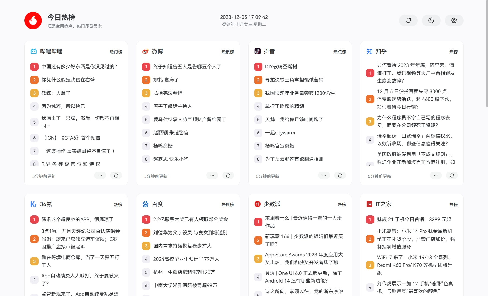

<div align="center">


# DailyHot · 新一代 AI 智能情报流与全网热点看板

<p align="center">
  <strong>告别低质信息茧房。用 AI 深度降噪，将全网核心要闻、宏观财经与极客科技浓缩于一条沉浸式流式情报中枢</strong>
</p>

<p align="center">
  <a href="https://v3.vuejs.org/"></a>
  <a href="https://vitejs.dev/"></a>
  <a href="https://www.naiveui.com/"></a>
  <a href="https://pinia.vuejs.org/"></a>
  <a href="https://www.deepseek.com/"></a>
  <a href="./LICENSE"></a>
</p>

<p align="center">
  <a href="#-为什么选择-dailyhot">核心优势</a> •
  <a href="#-杀手级特性">核心特性</a> •
  <a href="#-双模浏览形态">双模形态</a> •
  <a href="#-信源支持">集成信源</a> •
  <a href="#-极速起步">快速开始</a> •
  <a href="#-一键部署">部署说明</a>
</p>

<br />



</div>

---

## 💡 为什么选择 DailyHot？

传统的资讯看板与热点聚合，往往沦为**低质信息的垃圾场**：
- ❌ **信息碎片化**：用户必须逐个卡片点选，在 20+ 个信源之间频繁跳跃，耗时费力；
- ❌ **缺乏价值量化**：八卦口水与硬核技术并列摆放，标题党屡见不鲜；
- ❌ **阅读无记忆**：刷新一次就重新推一遍，看过的资讯无法标记，永远处于“信息过载”焦虑中。

**DailyHot 前端全面进化为「智能情报工作台」**：
> 依托 [DailyHotApi](https://github.com/imsyy/DailyHotApi) 强大的 DeepSeek AI 评分与原生 SQLite 持久化中枢，DailyHot 将传统的“静态卡片聚合”蜕变为**兼具 AI 量化降噪、流式沉浸阅读、悬浮交互校准与全端已读同步**的现代化数字早报。

---

## 🌟 杀手级特性矩阵

### 🌊 1. 全网聚合流式视图（Stream View · 全新重磅）
- **打破信源孤岛**：告别逐个点开卡片的繁琐，将所有激活的高价值信源（金十、财联社、彭博社、路透社、HN、V2EX 等）汇聚成**一条连续滚动的高效情报瀑布流**。
- **AI 优先级自动重排**：打完分的资讯自动按 AI 分数从高到低排列，高价值关键要闻开屏即见。
- **并发流水线可视化**：内置流式进度监控，实时展现各信源拉取进度、当前并发打分 Worker 状态与进度百分比。

### 🏷️ 2. AI 评分徽章（L1~L5）与独创悬浮即时滑块
- **五层智能色阶**：
  - <kbd>L1 90~100</kbd> **极度高能·必看**：现场工程破坏性变更、核心宏观利率决议
  - <kbd>L2 75~89</kbd> **深度要闻**：核心主力大模型正式发版、全球宏观博弈
  - <kbd>L3/L4 60~74</kbd> **行业脉搏**：AI 产业动态、高阶生产力工具
  - <kbd>Uncertain 40~59</kbd> **视野调剂**：反茧房探索资讯
  - <kbd>L5 0~39</kbd> **刚性降噪**：论坛情绪水帖、营销噱头已自动压制
- **悬浮即时滑块校准（Human-in-the-Loop）**：
  - 鼠标悬停在评分徽章上，立即展开交互滑块（0~100 分）；
  - 随意拖动即可一键修正打分并直连后端 SQLite 保存，**让人工智能在交互中真正理解你的个人偏好**！

### 👁️ 3. 智能已读追踪与极简 Inbox-Zero 体验
- **跨端已读记忆**：点击阅读后资讯自动灰显并打上已读标记，状态毫秒级同步至后端 SQLite 数据库。
- **一键隐藏已读（Hide Read）**：开启顶部状态栏的「隐藏已看过的内容」，瞬间清空信息流，享受清爽的“收件箱清零”快感，只看今日全网增量！

### 📊 4. 经典多列卡片看板（Board View）
- **双倍高度视野**：重新设计了经典卡片布局，单卡片高度扩展为 2 倍，一屏容纳更多资讯要点，减少滚动疲劳。
- **高度模块化**：在设置页中支持对 20+ 个信源自由拖拽排序、开启或关闭。

### 🎨 5. 现代美学与极致细节打磨
- **深色/浅色模式平滑切换**：支持跟随系统主题自动切换或手动固定，暗黑模式下柔和护眼。
- **自适应视口排版**：从手机端单手浏览，到 4K 宽屏多列并排，流体响应式布局浑然天成。
- **自定义阅读参数**：支持动态调节列表字号（14px~20px）以及外链打开方式（新窗口 / 当前窗口）。

---

## 📱 双模浏览形态

| 功能维度 | 🌊 全网聚合流式模式 (`/stream`) | 📊 经典多列看板模式 (`/`) |
| :--- | :--- | :--- |
| **适用场景** | 晨间 10 分钟全网高价值要闻速览、深度降噪阅读 | 宏观盘点各平台即时热搜、横向多端对比 |
| **排列规则** | 按 AI 智能打分降序排列，高能要闻置顶 | 按信源模块分列独立展示，保持官方排位 |
| **AI 交互** | 完整呈现评分徽章、推荐理由、悬浮调分滑块 | 专注呈现热度指数与原始排行 |
| **已读过滤** | 支持「隐藏已读」，实现真正的 Inbox-Zero | 支持视觉点击已读置灰 |
| **快捷筛选** | 顶部提供信源芯片 Tag，一秒定位特定源 | 通过侧边/页面快速滚动定位 |

---

## 🌐 聚焦高价值信源生态

全面聚焦**全球宏观财经、商业深度与前沿极客科技**：

```
├─ 宏观财经与即时快讯
│  ├─ 金十数据 (Jin10) · 7x24全球外汇/大宗/宏观要闻
│  ├─ 财联社 (CLS) · 7x24 A股/产业政策电报
│  └─ 界面新闻 (Jiemian) · 快报要闻与热门商业
├─ 全球商业与国际要闻 (内置 DeepSeek AI 并发中文化)
│  ├─ 彭博社 (Bloomberg) · 全球市场与头条要闻
│  └─ 路透社 (Reuters) · 国际/商业/科技/金融专栏
└─ 极客前沿与开源架构
   ├─ Hacker News · 全球前沿科技讨论
   ├─ GitHub Trending · 开源高星项目风向标
   ├─ V2EX · 程序员技术与极客社区
   ├─ 少数派 (SSPAI) · 深度效率与数字工作流
   └─ 掘金、IT之家、36氪 等高频前沿源
```

---

## ⚡ 极速起步

### 1. 克隆项目与安装依赖

推荐使用 [pnpm](https://pnpm.io/) 进行包管理：

```bash
# 克隆仓库
git clone https://github.com/imsyy/DailyHot.git
cd DailyHot

# 安装依赖
pnpm install
```

### 2. 配置后端 API

复制或新建 `.env` 文件：

```env
# 填入您的 DailyHotApi 后端服务地址（本地或线上部署的 API 节点）
VITE_GLOBAL_API="http://localhost:6688"

# 站点路由基准路径（默认为 /）
VITE_DIR="/"
```

> [!TIP]
> 为获得完整的 **AI 智能打分** 与 **SQLite 已读/校准同步** 体验，请搭配部署 [DailyHotApi](https://github.com/imsyy/DailyHotApi) 后端。

### 3. 本地开发与构建

```bash
# 启动本地热重载开发服务器
pnpm dev

# 打包构建生产版本静态资源
pnpm build

# 本地预览打包产物
pnpm preview
```

---

## 🚢 一键部署

### 方案 A：Vercel 一键上线（推荐）
本项目为纯前端静态单页应用（SPA），支持直接推送到 Vercel 托管平台：

[](https://vercel.com/new)

> **注意**：在 Vercel 控制台的项目环境变量中添加 `VITE_GLOBAL_API`，指向您的后端 API 地址。

### 方案 B：Nginx 静态托管
将 `pnpm build` 输出的 `dist` 目录上传至服务器，并配置 Nginx：

```nginx
server {
    listen 80;
    server_name hot.yourdomain.com;

    location / {
        root /var/www/dailyhot/dist;
        index index.html;
        try_files $uri $uri/ /index.html;
    }
}
```

---

## 🛠️ 技术底座

- **核心架构**：[Vue 3](https://v3.vuejs.org/)（Composition API + `<script setup>`）
- **工程构建**：[Vite 4](https://vitejs.dev/)（毫秒级极速 HMR）
- **组件库**：[Naive UI](https://www.naiveui.com/)（精美细致的现代化 Vue3 组件体系）
- **状态存储**：[Pinia](https://pinia.vuejs.org/) + `pinia-plugin-persistedstate`（本地持久化与跨会话状态管理）
- **图标体系**：[IconPark](https://iconpark.oceanengine.com/)

---

## 🤝 鸣谢与协同

- 后端核心服务：[DailyHotApi](https://github.com/imsyy/DailyHotApi)
- 原始灵感与开源项目：[imsyy/DailyHot](https://github.com/imsyy/DailyHot)

## 📄 开源许可证

本项目基于 [MIT License](./LICENSE) 协议开放，欢迎 Star 关注与参与贡献！
